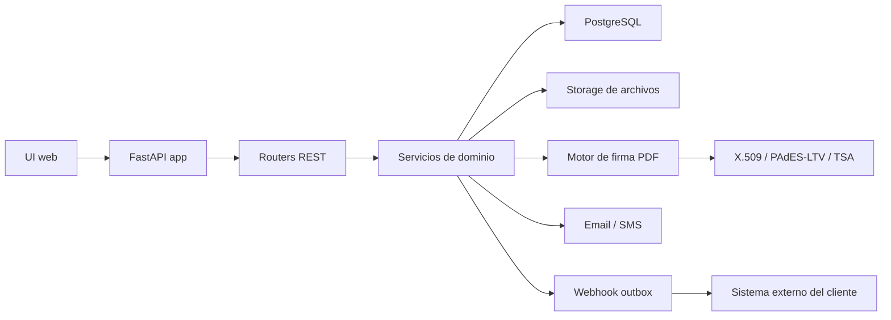
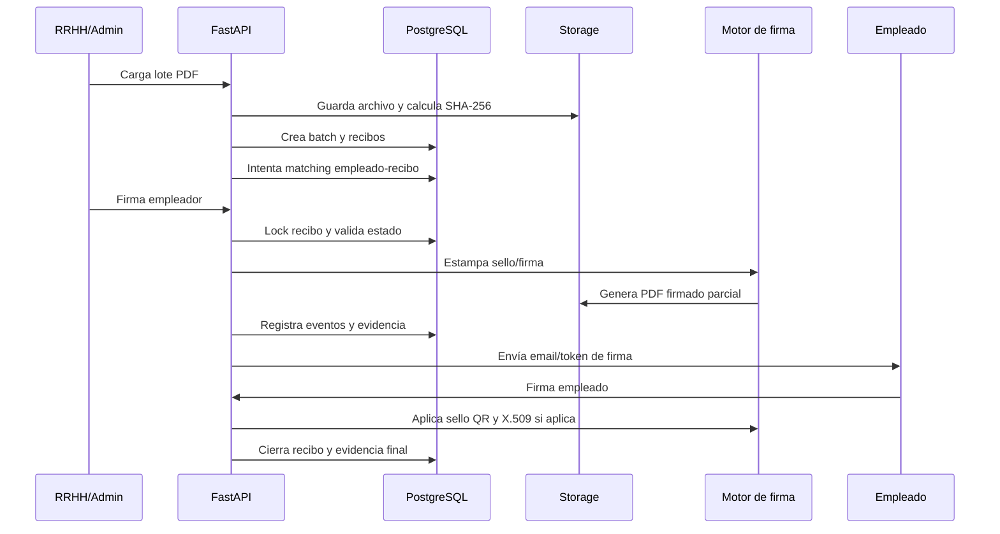

# Arquitectura de MyManageRH

## 1. Propósito

Este documento describe la arquitectura técnica de MyManageRH según los componentes presentes en el sistema: FastAPI, PostgreSQL, SQLAlchemy/Alembic, storage de archivos, firma visual, firma X.509/PAdES-LTV, auditoría y operación multi-tenant.

## 2. Arquitectura general

MyManageRH opera como una aplicación backend monolítica con módulos internos separados por responsabilidad. El diseño prioriza consistencia transaccional, trazabilidad, integridad de archivos y control de acceso por organización.

## 3. Componentes backend

| Componente | Responsabilidad observada |
| --- | --- |
| `main.py` | Inicializa FastAPI, middlewares, CORS, routers, health checks y loop de webhooks. |
| `payroll_core.py` | DB sessions, auth, sesiones, rate limiting, auditoría, storage seguro y utilidades de hash. |
| `config.py` | Variables de entorno, storage, límites, firma, OTP, SMTP, SMS, PKI/X.509, HSM y TSA. |
| `api/*.py` | Routers de auth, empleados, recibos, lotes, auditoría, PKI, documentos, notificaciones y administración. |
| `services/*.py` | Reglas de dominio, email, webhooks, documentos, PKI, X.509, verificación y firma. |
| `modules/digital_signature.py` | Flujo principal de firma por token, OTP, lock, procesamiento PDF y persistencia de evidencia. |
| `modules/signature.py` | Motor de firma visual, sellos QR, detección de posiciones y validación de integridad del PDF. |
| `file_processing/*.py` | Validación, optimización y procesamiento de PDF, imágenes, Excel, ZIP y cifrado de archivos sensibles. |
| `models/*.py` | Modelos SQLAlchemy, enums, tablas de negocio, auditoría, evidencia y PKI. |
| `alembic/` y `migrations/` | Migraciones de esquema, hardening, RLS, inmutabilidad y outbox. |

## 4. Frontend

La UI se encuentra en `ui/` y es servida como archivos estáticos por FastAPI. Incluye login, recuperación de contraseña, verificación de cuenta, dashboard de empresa, gestión de empleados, historial, configuración, firma del empleado y vista de documento unificado.

La UI consume endpoints REST y debe incluir encabezados compatibles con CSRF en producción, especialmente `X-Requested-With` para operaciones mutables bajo `/api/`.

## 5. Base de datos

La base principal es PostgreSQL. La aplicación usa SQLAlchemy, sesiones transaccionales y migraciones Alembic.

| Tabla/modelo | Uso principal |
| --- | --- |
| `organizations` | Tenant raíz y datos del empleador. |
| `users` | Identidades de administradores y empleados. |
| `user_sessions` | Sesiones hasheadas, expiración, IP y user-agent. |
| `verification_codes` | OTP y verificación de contexto de firma. |
| `employees` | Datos personales, laborales y de contacto. |
| `employee_extra_data` | Campos extendidos de legajo, AFIP/ANSES, banco y remuneración. |
| `company_signers` | Firmantes autorizados de la organización. |
| `payroll_batches` | Lotes de recibos cargados. |
| `payroll_receipts` | Recibos legacy de payroll. |
| `receipts` | Recibos enterprise/unificados. |
| `signature_requests` | Solicitudes y tokens de firma. |
| `signature_evidence` | Evidencia técnica y contextual del acto de firma. |
| `signature_events` | Eventos append-only de firma y transformación de PDF. |
| `receipt_seals` | Registro de sellos QR verificables. |
| `audit_log` | Registro transversal de acciones de usuarios/sistema. |
| `email_events` | Eventos de email: enviado, abierto, firmado o fallido. |
| `webhook_outbox` | Eventos pendientes, entregados o en dead-letter para integraciones externas. |
| `import_jobs` y `import_job_rows` | Importación y validación de empleados/legajos. |
| `notifications` | Notificaciones internas con adjuntos opcionales. |
| `pki_key_metadata` | Metadata de llaves PKI versionadas. |

## 6. Storage

El storage se configura mediante `STORAGE_PATH` y se resuelve a `ALLOWED_STORAGE_DIR`.

| Categoría | Uso |
| --- | --- |
| `[STORAGE_PATH]/batches` | PDFs cargados en lote. |
| `[STORAGE_PATH]/receipts` | Recibos individuales o PDFs procesados. |
| `[STORAGE_PATH]/signatures/employer` | Firmas o sellos del empleador. |
| `[STORAGE_PATH]/signatures/employee` | Firmas del empleado o snapshots asociados. |
| `[STORAGE_PATH]/identity` | Imágenes DNI u otros documentos sensibles de identidad. |
| `[STORAGE_PATH]/imports` | Archivos de importación de legajos/empleados. |
| `[STORAGE_PATH]/forensics/failed_signatures` | Cuarentena de archivos fallidos cuando el flujo lo genera. |

Controles observados:

- `safe_join_under_storage` evita path traversal usando `commonpath`.
- `build_storage_path` fuerza segregación por organización y sanitiza nombre de archivo/subcarpeta.
- Escrituras atómicas mediante archivos temporales y `os.replace`.
- Hash por chunks antes o después de operaciones críticas.

## 7. Motor de firma

| Capa | Implementación |
| --- | --- |
| Firma visual | `modules/signature.py`, PyMuPDF, imagen PNG/canvas y sello QR. |
| Orquestación | `modules/digital_signature.py`, validación, lock, procesamiento, finalización DB. |
| Firma criptográfica | `services/x509_service.py`, pyHanko, X.509, PAdES-LTV, TSA y P12/HSM. |
| Evidencia | `signature_evidence`, `signature_events`, `receipt_seals`, hashes y metadata X.509. |

Fases relevantes:

1. Validar estado, identidad y permisos dentro de una transacción bloqueada.
2. Procesar PDF fuera de la transacción larga para reducir bloqueo de base de datos.
3. Aplicar sello visual, QR y firma X.509 si corresponde.
4. Confirmar cambios de DB, evidencia, hashes, estado y eventos.
5. Limpiar `processing_signature` si ocurre un fallo.

## 8. Servicios de email y webhooks

`services/email_service.py` soporta modo consola/sandbox y SMTP real para emails de firma, OTP, notificaciones y recuperación de contraseña. `services/sms_service.py` contempla OTP vía Twilio si `SMS_MODE=twilio`.

`services/webhook_service.py` implementa transactional outbox:

- Inserta eventos dentro de la misma transacción que el cambio de estado.
- Usa clave de idempotencia por recibo y acción.
- Firma payloads con HMAC-SHA256 si `PAYROLL_WEBHOOK_SECRET` está configurado.
- Reintenta con backoff exponencial.
- Mueve a `dead_letter` tras `WEBHOOK_MAX_RETRIES`.

## 9. Separación multi-tenant

La separación multi-tenant se basa en:

- `organization_id` o `company_id` como campo de tenant.
- Filtros explícitos por organización en endpoints y servicios.
- Path builder con organización dentro de la ruta de storage.
- Sesiones asociadas a usuario y organización.
- Scripts de RLS para PostgreSQL y seteo de `app.current_org_id` en sesión autenticada.

Requisito operativo: confirmar en producción que las políticas RLS están aplicadas, que el usuario de base de datos no bypassa RLS y que las migraciones de hardening fueron ejecutadas.

## 10. Flujo de datos

## 11. Estados principales del recibo

| Estado | Significado |
| --- | --- |
| `pending_match` | El recibo requiere asociación manual con un empleado. |
| `processing` | El recibo está siendo procesado. |
| `pending_signature` | El recibo está pendiente de firma. |
| `pending_employer_signature` | Requiere firma del empleador. |
| `pending_employee_signature` | Requiere firma del empleado. |
| `signed` | Estado terminal esperado para recibo firmado y bloqueado. |
| `rejected` | Estado terminal por rechazo explícito. |

Estados de solicitud de firma: `pending`, `signed`, `rejected`, `expired`.

## 12. Decisiones arquitectónicas relevantes

| Decisión | Justificación | Implicancia |
| --- | --- | --- |
| Monolito FastAPI | Simplifica consistencia transaccional y despliegue inicial. | Escalado horizontal requiere storage compartido. |
| PostgreSQL como fuente de verdad | ACID, locks, restricciones, RLS y triggers. | DB es componente crítico de disponibilidad. |
| Storage externo al DB | PDFs y archivos pueden crecer significativamente. | Backup debe cubrir DB y storage de forma consistente. |
| Hash SHA-256 por archivo | Permite integridad y detección de alteración. | Cambios fuera del sistema invalidan flujos o evidencia. |
| Outbox transaccional | Evita perder eventos de integración. | Requiere monitoreo de `pending` y `dead_letter`. |
| Firma en fases | Reduce tiempo de locks DB y mejora recuperación de fallos. | Requiere limpieza de flags y cuarentena ante fallos. |
| Tokens hasheados | Reduce impacto si se expone la base de datos. | El token raw sólo debe enviarse por canales controlados. |
| RLS preparado | Defensa adicional para multi-tenancy. | Debe validarse su aplicación real por ambiente. |

## 13. Riesgos conocidos y mitigaciones

| Riesgo | Mitigación actual o requerida |
| --- | --- |
| Certificados privados en entornos locales | No versionar llaves reales; usar secretos/KMS/HSM en producción; revisar `.gitignore`. |
| Cifrado de archivos DNI aún placeholder | Implementar AES-256-GCM/KMS o storage cifrado antes de producción enterprise. |
| Storage local en despliegue multi-nodo | Usar volumen compartido o storage objeto con garantías de consistencia. |
| Doble firma o carrera concurrente | Locks `FOR UPDATE`, `processing_signature` y estados terminales. |
| Falla de TSA/PKI | Fail-fast si la política requiere firma criptográfica; definir fallback permitido por Legal. |
| PII en logs | Filtro de enmascaramiento y `redact_pii`; validar cobertura y centralización. |
| RLS no aplicado en DB real | Ejecutar scripts/migraciones y testear aislamiento por organización. |
| Webhooks acumulados | Monitorear retries y dead-letter; definir runbook. |
| CORS/CSRF mal configurado | Usar orígenes explícitos, cookies SameSite y header `X-Requested-With`. |
| Retención legal definida | Recibos y evidencia: 5-10 años. Logs técnicos: 1 año. Ajustar por cliente/jurisdicción. |
