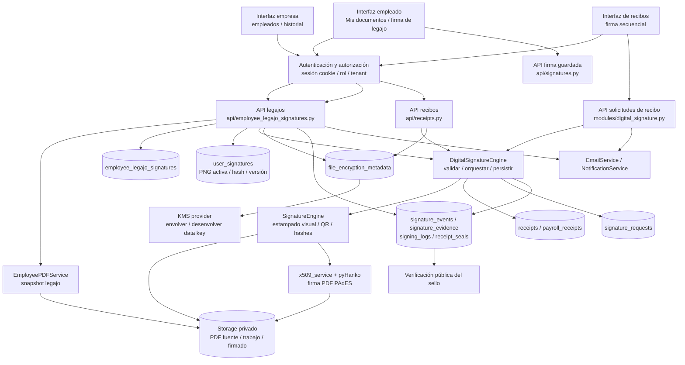

# Informe integral de firma electrónica en MyManageRH

**Fecha de relevamiento:** 27 de octubre de 2026  
**Base revisada:** código del repositorio en `main`, commit `1badc0f` (`security: harden authentication and document handling`).  
**Alcance:** flujos de firma de legajos, recibos, documentos cargados por usuarios, firma visual, firma PDF X.509, autenticación, OTP, almacenamiento, cifrado, sellos, evidencia, interfaces, operación y límites detectados.  
**Naturaleza del informe:** análisis estático del código y documentación del repositorio. No acredita qué migraciones están aplicadas ni qué proveedores, certificados, TSA, HSM, servicios de correo o controles de infraestructura están operativos en producción.

> **Conclusión ejecutiva:** MyManageRH contiene varios procesos técnicos de aceptación y estampado de documentos. El flujo específico de legajos genera un PDF snapshot, lo conserva cifrado, exige que el empleado autenticado confirme el CUIL, aplica el motor de sellado a las páginas y conserva el documento firmado en el historial empresarial. Los recibos tienen un flujo diferente, con firma secuencial empleador/empleado, estados propios, solicitudes y evidencia más extensa. En ambos casos conviven conceptos distintos: una imagen/sello visible, autenticación del usuario y, cuando la infraestructura lo permite, una firma criptográfica X.509 sobre el PDF. El código por sí solo no demuestra que la solución constituya una firma digital con validez certificada en sentido legal.

## Índice

1. [Resumen funcional](#1-resumen-funcional)
2. [Alcance y vocabulario](#2-alcance-y-vocabulario)
3. [LA ARQUITECTURA COMPLETA EXCLUSIVAMENTE DE LA FIRMA ELECTRÓNICA](#3-la-arquitectura-completa-exclusivamente-de-la-firma-electrónica)
4. [Ciclo de firma de legajos](#4-ciclo-de-firma-de-legajos)
5. [Firma de recibos de haberes](#5-firma-de-recibos-de-haberes)
6. [Otros usos del motor de firma](#6-otros-usos-del-motor-de-firma)
7. [Interfaz y superficies HTTP](#7-interfaz-y-superficies-http)
8. [Persistencia y ciclo de vida](#8-persistencia-y-ciclo-de-vida)
9. [Qué se estampa en el PDF y cómo se procesa](#9-qué-se-estampa-en-el-pdf-y-cómo-se-procesa)
10. [Identidad, autenticación y consentimiento](#10-identidad-autenticación-y-consentimiento)
11. [Cifrado, certificados, TSA, HSM y KMS](#11-cifrado-certificados-tsa-hsm-y-kms)
12. [Evidencia, auditoría y verificación](#12-evidencia-auditoría-y-verificación)
13. [Errores, concurrencia, idempotencia y recuperación](#13-errores-concurrencia-idempotencia-y-recuperación)
14. [Configuración y dependencias operativas](#14-configuración-y-dependencias-operativas)
15. [Pruebas que existen y validación pendiente](#15-pruebas-que-existen-y-validación-pendiente)
16. [Diferencias entre diseño documentado y código observado](#16-diferencias-entre-diseño-documentado-y-código-observado)
17. [Riesgos y decisiones pendientes](#17-riesgos-y-decisiones-pendientes)
18. [Guía de revisión/auditoría de una firma](#18-guía-de-revisiónauditoría-de-una-firma)
19. [Fuentes principales del repositorio](#19-fuentes-principales-del-repositorio)

## 1. Resumen funcional

MyManageRH mantiene tres rutas principales que deben analizarse por separado:

| Proceso | Qué firma | Quién firma | Dónde queda |
|---|---|---|---|
| **Legajo de empleado** | Snapshot PDF generado desde la ficha del empleado y datos laborales asociados. | Empleado autenticado, tras comprobar CUIL y usar la imagen de firma que tiene guardada. | Registro propio `employee_legajo_signatures`; historial de la empresa. Se lista para el empleado únicamente mientras está pendiente. |
| **Recibo de haberes** | Documento de recibo asociado a `receipts` o `payroll_receipts`. | Empresa y empleado, en orden determinado por el estado y los requisitos del recibo. | Tablas de recibos, solicitud de firma, eventos, evidencia y sello. |
| **Documento cargado por el empleado** | PDF que el empleado sube a una sección permitida, como nómina, fondo de desempleo o varios. | Empleado autenticado con su firma guardada. | Repositorio de documentos del tipo seleccionado; no es el ciclo de solicitud de legajo ni el mismo historial de recibos. |

El backend reutiliza en estos flujos componentes comunes:

- `modules.digital_signature.DigitalSignatureEngine`, que coordina el procesamiento de firma y los cambios de estado de recibos.
- `modules.signature.SignatureEngine`, que manipula el PDF y agrega la representación visible/sello QR.
- `services.x509_service`, que firma el PDF con pyHanko y un certificado/key signer cuando puede configurarse.
- `services.encryption_service`, que aplica cifrado de envelope a archivos sensibles y mantiene metadata en `file_encryption_metadata`.
- `api.signatures`, que mantiene la imagen de firma manuscrita del usuario en `user_signatures`.
- Persistencia, auditoría, notificaciones, correo, registro de eventos y archivos controlados por organización.

La firma de legajo **no** reutiliza la fila de recibo ni la state machine de recibos: tiene tabla, autorización, endpoint de firma y estados propios. Comparte las operaciones de PDF/PKI y el registro general `receipt_seals`.

## 2. Alcance y vocabulario

### 2.1 Términos usados en este informe

- **Imagen de firma:** PNG que el usuario guardó previamente o imagen capturada en canvas. Es un activo visual reutilizable; no es una clave privada.
- **Estampado o firma visual:** imagen y/o bloque informativo dibujado en las páginas PDF. Se puede leer visualmente, pero una imagen por sí sola no prueba quién la insertó ni protege criptográficamente el archivo.
- **Sello MyManageRH:** bloque visible de validación que puede mostrar identidad, rol, CUIL/DNI, hora, identificador y QR. El QR apunta a una consulta de verificación.
- **Firma criptográfica del PDF:** firma X.509/PAdES que protege criptográficamente el contenido del PDF y se valida con certificado y herramientas compatibles. Depende de la configuración PKI.
- **Firma electrónica:** término funcional usado por la interfaz y el negocio para el acto registrado en la aplicación. La calificación jurídica concreta no se determina solamente por el nombre del botón o por el código.
- **Firma digital en sentido legal:** categoría jurídica cuyo cumplimiento depende, entre otras cosas, del marco normativo, certificados, autoridad y procedimiento aplicables. Este informe no certifica que un certificado interno de MyManageRH sea un certificado legalmente reconocido para ese fin.
- **TSA:** autoridad de sellado de tiempo RFC 3161 configurada para respaldar el momento de una firma criptográfica.
- **KMS/Transit:** servicio para proteger claves de cifrado de archivos. No es lo mismo que el certificado de firma PDF ni sustituye una TSA.

### 2.2 Separación importante

Los siguientes controles aportan cosas distintas y no deben confundirse:

1. La sesión identifica a una cuenta activa dentro de la aplicación.
2. El correo/token identifica una solicitud concreta o ayuda a localizarla.
3. El CUIL coteja un dato presentado con el CUIL guardado para ese snapshot.
4. La imagen PNG se representa en el documento.
5. El sello QR vincula visualmente un identificador y una verificación de servidor.
6. El cifrado KMS protege el archivo almacenado en disco.
7. La firma X.509/PAdES, si se ejecuta correctamente, protege criptográficamente el PDF.

Ninguno de los puntos 1–6, tomado de forma aislada, equivale a una firma criptográfica del documento. Tampoco una respuesta HTTP `status: signed` demuestra por sí sola que el certificado, el sello de tiempo o la política de verificación externos estén disponibles y sean confiables.

## 3. LA ARQUITECTURA COMPLETA EXCLUSIVAMENTE DE LA FIRMA ELECTRÓNICA

Esta sección está dedicada exclusivamente a la arquitectura del acto de firma: interfaces, controladores, reglas, motor documental, criptografía, almacenamiento y evidencias. No describe otros subsistemas de RR. HH. salvo cuando proveen datos al documento.

### 3.1 Diagrama por capas



### 3.2 Componentes y responsabilidades de firma

| Componente | Responsabilidad en la firma |
|---|---|
| `ui/pages/empresa-empleados/` | Interfaz de gestión de empleados. En la tabla actual se ven acciones Editar y DNI OCR; el botón de tres puntos para iniciar la firma de legajo no aparece en el componente inspeccionado. |
| `ui/pages/empresa-historial.js` | Pestaña Legajos para que la empresa vea solicitud, estado, fechas y abra la fuente o el PDF firmado. |
| `ui/pages/empleado-recibos.js` | Presenta solicitudes de legajo pendientes en Mis Documentos y permite previsualizar o navegar a la pantalla de firma. No agrega a esa lista una fila de legajo completado. |
| `ui/pages/legajo-firma.js` | Muestra datos de solicitud, previsualiza el PDF, pide CUIL y confirma la operación antes de llamar a firmar. |
| `ui/pages/sign.js` | Interfaz distinta para recibos con token; contiene componentes de OTP, revisión, canvas, CUIL y aceptación/rechazo. La ruta de OTP se activa según `requires_verification` recibido. |
| `api/employee_legajo_signatures.py` | Crear solicitud, listar pendientes del empleado, consultar/previsualizar, firmar, listar historial de empresa y entregar PDFs a la empresa. |
| `api/receipts.py` | Operaciones de recibos: firma empresarial, firma simple, tokens, recordatorios, descargas y verificación del sello. |
| `modules/digital_signature.py` | Router de solicitudes de firma de recibos y orquestador `DigitalSignatureEngine`; contiene validación, preparación de PDF, aceptación/rechazo y OTP frictionless de recibos. |
| `modules/signature.py` | Motor PDF agnóstico a HTTP/DB para imagen, sello visible, QR, metadatos y hash. |
| `services/x509_service.py` | Firma PDF criptográfica mediante pyHanko, P12 o PKCS#11 según configuración, validación PKI y TSA. |
| `services/encryption_service.py` | Cifrado AES-256-GCM por archivo con data key y KEK administrada por proveedor KMS; persiste metadata/auditoría. |
| `services/signature_service.py` y `payroll_core.py` | Validar token de solicitudes de recibos, buscar datos relacionados y crear solicitudes. |
| `api/signatures.py` | Capturar/guardar la imagen de firma del usuario, versionarla y dar acceso autenticado a la imagen. |

### 3.3 Flujo interno de una operación de firma

```mermaid
sequenceDiagram
    participant Actor as Empleado o empresa
    participant UI as Interfaz
    participant API as Endpoint de firma
    participant DB as PostgreSQL
    participant Storage as Storage privado
    participant Engine as SignatureEngine
    participant PKI as x509_service / TSA
    participant KMS as KMS de cifrado

    Actor->>UI: Confirma el acto de firma
    UI->>API: Solicitud autenticada y datos de firma
    API->>DB: Autoriza usuario, tenant, documento, estado e idempotencia
    API->>Storage: Lee snapshot y activo de firma
    API->>KMS: Descifra temporalmente el PDF si está cifrado
    API->>Engine: Estampa imagen/bloque/QR, valida tamaño, páginas y hashes
    Engine->>PKI: Firma criptográfica del PDF si el flujo/config la exige
    PKI-->>Engine: PDF firmado, fingerprint y metadata o fallo
    Engine-->>API: Archivo temporal y resultado
    API->>KMS: Cifra el artefacto final cuando corresponde
    API->>DB: Estado final, hash y evidencia/auditoría
    API-->>UI: Resultado firmado o error
```

El diagrama es una vista lógica común. En el flujo de legajo, los controles de solicitud y finalización viven en su router propio. En recibos, la operación de firma principal de `DigitalSignatureEngine` se divide expresamente en tres fases: validar/bloquear en DB; procesar PDF fuera de la transacción y del event loop; finalizar DB en transacción.

## 4. Ciclo de firma de legajos

### 4.1 Antes del envío

El endpoint empresarial `POST /api/employee-legajos/{employee_id}/send`:

1. Requiere usuario con privilegio `require_admin`.
2. Obtiene `organization_id` desde la sesión; busca al empleado restringiendo por ese tenant.
3. Rechaza empleado inexistente o eliminado, dirección de correo vacía/inválida y CUIL faltante o no válido.
4. Expira solicitudes previas vencidas del mismo empleado/organización al intentar emitir una nueva.
5. Rechaza si queda una solicitud pendiente.
6. Genera el PDF con `EmployeePDFService.generate_record_pdf(employee_id, organization_id)`.
7. Verifica que el PDF no esté vacío, respete `MAX_FILE_SIZE` y tenga entre una y `MAX_PDF_PAGES` páginas.

El PDF generado actualmente incluye secciones de datos personales, laborales, bancarios, declaración de domicilio, familia, ropa y sindicato, según los datos disponibles. Puede incluir DNI, CUIL, fecha de nacimiento, correo, teléfono, domicilio y datos bancarios. Es información personal sensible y la versión exacta enviada queda fijada por el snapshot.

### 4.2 Snapshot, token y notificación

- Se crea UUID para la solicitud/directorio.
- Se genera un secreto aleatorio con `secrets.token_urlsafe(32)`; en DB se persiste `hash_token(raw_token)`, no el token en claro.
- La carpeta se crea bajo `storage/employee_legajo_signatures/{organization_id}/{signature_id}` con permisos de directorio `0700`; el archivo inicial se escribe con permisos `0600`, `fsync` y creación exclusiva.
- Se calcula SHA-256 del PDF original.
- El PDF fuente se cifra in-place mediante `EncryptionService.encrypt_file_in_place`, con propósito `employee_legajo_signature_source`; la metadata y auditoría se persisten en una transacción.
- La fila se inserta en `employee_legajo_signatures` con empleado/tenant/emisor, snapshot de nombre/correo/CUIL, ruta/hash del PDF, hash del token, vencimiento de siete días, IP/user-agent del emisor y estado `pending`.
- La tabla tiene un índice único parcial para impedir dos filas `pending` para el mismo par organización/empleado.
- Luego se envía correo al email tomado del registro de empleado con link de firma en el fragmento de la URL `#/empleado/legajo-firma/{token}`. El texto comunica solicitud, revisión del documento, confirmación de CUIL y expiración en siete días.
- Si el envío del correo falla, el endpoint marca la fila como `cancelled` e informa error HTTP 502; no devuelve éxito.

La expiración no depende de un job periódico visible en este flujo: el listado del empleado excluye solicitudes vencidas, el acceso a una solicitud las rechaza, el historial de empresa calcula `expired` al responder y el envío siguiente cambia pendientes vencidas a estado `expired`.

### 4.3 Acceso y vista previa del empleado

La UI del empleado:

1. Consulta `GET /api/employee-legajos/pending`.
2. Muestra exclusivamente solicitudes pendientes y vigentes del empleado autenticado y su organización.
3. Permite abrir una previsualización PDF o la vista “Firmar ahora”.
4. La pantalla de firma consulta el detalle y muestra empresa, persona y fecha de solicitud.
5. Si el usuario no tiene una firma guardada, ofrece navegación a Mi Perfil.
6. Con firma guardada, incrusta la ruta PDF pendiente y pide que el empleado escriba su CUIL.
7. Pide confirmación explícita de que se firmará el legajo completo y envía el CUIL al backend.

El endpoint revisa rol `employee`, `employee_id` y `organization_id` contra la fila; un registro ajeno se responde como no encontrado. El PDF fuente se descifra a un archivo temporal y se elimina al completar la respuesta HTTP.

### 4.4 Firma del legajo

`POST /api/employee-legajos/pending/{identifier}/sign` hace estos controles/operaciones:

1. Busca por ID o por hash del token y requiere empleado/organización correctos.
2. Rechaza solicitud que no esté `pending` o ya vencida.
3. Normaliza el CUIL ingresado y el guardado en la solicitud; valida formato y coincidencia exacta. La solicitud se creó solo con un CUIL que ya superó el validador.
4. Busca la imagen de firma `user_signatures` activa del usuario autenticado; resuelve la ruta dentro de storage, lee bytes y compara SHA-256 con `signature_hash`.
5. Reclama el trabajo mediante actualización condicional `processing_signature=false` → `true`, bajo estado `pending` y solicitud aún vigente. Si otra llamada ya reclamó, responde conflicto.
6. Descifra el snapshot fuente y prepara un `working.pdf` de acceso restringido.
7. Construye el contexto `doc_type=EMPLOYEE_LEGAJO`, `source=employee_legajo` y `apply_to_all_pages=true`, con nombre, email y CUIL del actor.
8. Ejecuta `DigitalSignatureEngine.process_pdf` en un pool de hilos para no ocupar el event loop con procesamiento PDF.
9. Requiere `generated_seal_id`; copia el resultado final a `signed.pdf`, calcula SHA-256 y cifra el archivo firmado con propósito `employee_legajo_signature_signed`.
10. En una transacción final, persiste metadata de cifrado, pasa estado a `signed`, apaga el flag, registra usuario, rutas, hash final, hash de imagen usada, seal ID, IP, user-agent y timestamp.
11. Inserta una fila en `receipt_seals` que marca `document_type=employee_legajo`, hash de snapshot, hash de imagen y `pages_stamped=true`.
12. Inserta evento de auditoría `EMPLOYEE_LEGAJO_SIGNED`.
13. Limpia archivo de trabajo, PDF descifrado y resultado PDF temporal al terminar.

El motor recibe la misma imagen PNG una sola vez por operación. `apply_to_all_pages=true` recorre todas las páginas e intenta aplicar sello en cada una. La inserción de la imagen manuscrita depende del modo/versionado del motor PDF; el sello de validación se repite por página en este modo. Por eso “una sola firma” describe un solo acto/solicitud de firma, no una sola marca gráfica en todo el documento.

### 4.5 Después de firmar

- `GET /api/employee-legajos/pending` filtra `status='pending'` y fecha de expiración futura. Una firma completada desaparece del listado del empleado.
- La ruta de detalle/previsualización pendiente deja de servir el documento una vez firmado.
- La UI del empleado navega de vuelta a Mis Documentos tras el éxito.
- `GET /api/employee-legajos/history`, accesible a admin de empresa, mantiene registro con estado/fechas/empleado y hasta 2000 resultados.
- `GET /api/employee-legajos/{legajo_id}/pdf?version=signed` entrega el PDF firmado solo a admin del tenant correspondiente; `version=source` permite ver la copia enviada.
- El historial del empleado (`/api/receipts/my-history`) es de recibos, no incorpora el registro de legajo firmado.

## 5. Firma de recibos de haberes

### 5.1 Modelo de documento y estados

Hay dos generaciones de persistencia que el repositorio mantiene por compatibilidad:

- `payroll_receipts` para recibos del esquema de nómina.
- `receipts` para documentos de arquitectura enterprise.

`DocumentRepository` resuelve el documento y adapta sus columnas. `signature_requests` también permite enlazar recibo legacy o enterprise mediante `receipt_id` / `enterprise_receipt_id`.

Los estados de recibo vistos en el flujo incluyen `pending`, `uploaded`, `pending_match`, `pending_signature`, `pending_employer_signature`, `pending_employee_signature`, `signed` y `rejected`. La transición final depende de `requires_employer`, `requires_employee` y de si el otro actor firmó previamente.

### 5.2 Firma del empleador

`POST /api/receipts/{receipt_id}/sign-employer`:

- Requiere `require_admin` y obtiene la organización desde la sesión.
- Acepta imagen de firma entregada para esa llamada o un `company_signer_id` que resuelve el perfil del firmante.
- La firma se puede permitir como sello-only bajo ciertas condiciones de configuración; en otros modos, la ausencia de imagen genera error.
- Llama a `_perform_employer_signature`, que delega en el motor común.
- Una vez completada, responde datos de estado/hash y nombre/email del empleado; no devuelve el token del empleado en esa respuesta.
- Si el siguiente estado es pendiente de firma del empleado, se genera una `signature_request` y se programa una notificación mediante `NotificationService`.

### 5.3 Solicitud y acceso del empleado

- `POST /api/receipts/{receipt_id}/token` es una operación de admin de recibo que crea token bajo estado permitido.
- `POST /api/receipts/{receipt_id}/remind-signature` renueva solicitud/notificación para recibo en `pending_employee_signature`.
- `POST /api/receipts/{receipt_id}/token/me` permite al empleado obtener una solicitud para un recibo que el backend asocia con su cuenta.
- `create_signature_request` guarda hash de token, fecha de expiración, emisor, IP y user-agent; elimina solicitudes pendientes anteriores para el documento y crea una nueva.
- El token se genera con `secrets.token_urlsafe(32)` y se guarda como hash. El helper `validate_and_fetch_signature_request` valida formato, compara hash, expira solicitudes pendientes y recupera datos de identidad/documento.
- La duración del token de recibo proviene de `TOKEN_TTL_HOURS` y el fallback del helper es 48 horas. Es distinta de los siete días del flujo de legajo.

### 5.4 OTP y autenticación de recibos

El código contiene rutas OTP específicas `/{token}/send-otp` y `/{token}/verify-otp`, con envío por SMS/email, código HMAC, límite de intentos y sesión temporal cookie `HttpOnly` para ese flujo público.

La información entregada por `GET /api/signature-requests/{token}/info` actualmente asigna `requires_verification=false` (el comentario del endpoint indica que el OTP se retiró operativamente en favor del token de solicitud). La UI `ui/pages/sign.js` decide mostrar OTP según ese campo: si es `false`, marca la verificación como satisfecha; de lo contrario, llama a los endpoints OTP. Por tanto:

- Los endpoints OTP siguen presentes.
- La UI conserva la experiencia y handlers OTP.
- El camino nominal actual reportado por `sign_info` no pide OTP si devuelve `false`.
- El flujo de legajo no usa esos endpoints OTP: exige sesión de empleado y CUIL.

Esto debe tratarse como una diferencia real entre disponibilidad del endpoint y activación del factor en el flujo estándar. Confirmar el valor efectivo del endpoint en staging antes de afirmar qué factor se aplicó a un recibo particular.

### 5.5 Confirmar o rechazar

- `POST /api/signature-requests/{token}/accept` verifica token/estado/identidad y aplica firma de empleado.
- Acepta imagen de canvas o literal `STORED_SIGNATURE`; la imagen guardada solo se admite para su propio usuario/empleado. La verificación de CUIL ocurre en el flujo.
- `POST /api/signature-requests/{token}/reject` exige usuario autenticado y email coincidente con el receptor; solo permite rechazar solicitud pendiente y registra razón/estado/evento.
- Los estados firmados/rechazados son terminales en los helpers de estado.

### 5.6 Pipeline de recibos en tres fases

1. **Fase 1 — validar y bloquear:** bajo transacción y `FOR UPDATE`, valida tenant, estado, `document_locked`, flag de procesamiento, rol y requisitos. Marca `processing_signature`.
2. **Fase 2 — procesar PDF:** fuera de transacción y del loop asíncrono, valida ruta/archivo/límites; estampa; calcula hashes; intenta firma X.509 si hay identidad; produce PDF temporal.
3. **Fase 3 — finalizar:** actualiza recibo, fecha y estado, bloquea documento si terminal; sincroniza el modelo legacy/enterprise; registra sello, evento, signing log y evidencia; actualiza solicitud; genera webhook en estado terminal cuando aplica.

En fallo, limpia el flag; el PDF parcial puede enviarse a cuarentena forense. Un fallo de PKI no debe convertirse silenciosamente en éxito visual.

## 6. Otros usos del motor de firma

`POST /api/signatures/user/upload-sign` permite a un empleado cargar un PDF y firmarlo con su imagen guardada. Solo acepta secciones `PAYROLL`, `UNEMPLOYMENT` y `MISC`; guarda el resultado con metadata `signed_by_employee`, origen de imagen y hash de firma. No es el flujo de legajo y no genera una solicitud empresa→empleado.

El endpoint usa `DigitalSignatureEngine.process_pdf`, pero no integra la misma state machine de `signature_requests` ni la fila de legajo. Los documentos se persisten mediante `DocumentService`.

## 7. Interfaz y superficies HTTP

### 7.1 Pantallas observadas

| Pantalla | Función observada |
|---|---|
| `ui/pages/legajo-firma.js` | Revisión de PDF de legajo pendiente, verificación de que hay firma guardada, ingreso de CUIL, confirmación y POST de firma. |
| `ui/pages/empleado-recibos.js` | Sección de legajos pendientes dentro de Mis Documentos, acciones Ver PDF y Firmar ahora. No lista los firmados como historia de empleado. |
| `ui/pages/empresa-historial.js` | Tab Legajos con enviado, empleado, email, estado, fecha de creación y firma; ver PDF fuente o firmado según estado. |
| `ui/pages/sign.js` | Vista del recibo con identidad, OTP condicional, PDF, CUIL, canvas/imagen, aceptar o rechazar. |
| `ui/pages/empresa-empleados/table.js` | La tabla actual tiene Editar y DNI OCR en Acciones. No se encontró allí el menú de tres puntos para enviar legajo. |

### 7.2 Rutas principales del flujo de legajo

| Método y ruta | Acceso esperado | Uso |
|---|---|---|
| `POST /api/employee-legajos/{employee_id}/send` | Admin | Crear snapshot y solicitud, cifrar, enviar email. |
| `GET /api/employee-legajos/pending` | Empleado | Listar pendientes vigentes propios. |
| `GET /api/employee-legajos/history` | Admin | Listar historial de la empresa (máximo 2000). |
| `GET /api/employee-legajos/pending/{identifier}` | Empleado relacionado | Obtener detalle y si hay firma guardada. `identifier` acepta ID o token original. |
| `GET /api/employee-legajos/pending/{identifier}/pdf` | Empleado relacionado | Previsualizar PDF fuente descifrado en temporal. |
| `POST /api/employee-legajos/pending/{identifier}/sign` | Empleado relacionado | Confirmar CUIL, estampar y finalizar. |
| `GET /api/employee-legajos/{legajo_id}/pdf?version=source` | Admin del tenant | Descargar/ver snapshot enviado. |
| `GET /api/employee-legajos/{legajo_id}/pdf?version=signed` | Admin del tenant, documento firmado | Descargar/ver snapshot firmado. |

### 7.3 Rutas comunes relacionadas con recibos

| Método y ruta | Función |
|---|---|
| `POST /api/receipts/{receipt_id}/sign-employer` | Firma del empleador. |
| `POST /api/receipts/{receipt_id}/simple-sign` | Firma de recibo desde la cuenta de usuario según ownership. |
| `POST /api/receipts/{receipt_id}/token` | Crear solicitud de firma de empleado desde empresa. |
| `POST /api/receipts/{receipt_id}/remind-signature` | Reenviar recordatorio/token de recibo pendiente. |
| `POST /api/receipts/{receipt_id}/token/me` | Crear/obtener solicitud propia de recibo como empleado. |
| `GET /api/signature-requests/{token}/info` | Consultar la información permitida del documento y estado de solicitud. |
| `GET /api/signature-requests/{token}/view` | Vista del PDF para token de solicitud, con ownership cuando hay sesión. |
| `GET /api/signature-requests/{token}/page/{page_num}` | Renderizar página de recibo como imagen. |
| `POST /api/signature-requests/{token}/send-otp` | Emitir OTP para flujo de solicitud de recibo cuando se requiere. |
| `POST /api/signature-requests/{token}/verify-otp` | Consumir OTP y crear sesión temporal. |
| `POST /api/signature-requests/{token}/accept` | Aceptar/firmar recibo. |
| `POST /api/signature-requests/{token}/reject` | Rechazar solicitud de recibo. |
| `GET /api/receipts/v/{seal_id}` | Consultar registro público de sello. |

### 7.4 Endpoints de firma guardada

- `GET /api/signatures/user/me`: indica si hay imagen de firma activa.
- `POST /api/signatures/user/save`: recibe imagen base64/canvas o carga, valida formato/tamaño, optimiza, calcula hash y versiona.
- `GET /api/signatures/user/image`: sirve la firma propia si está autorizada.
- `GET /api/signatures/receipt/{receipt_id}/image`: sirve snapshot visual de una firma de recibo; no sustituye al original registrado con el acto.

## 8. Persistencia y ciclo de vida

### 8.1 Solicitudes de legajo

La migración `alembic/versions/20261025_employee_legajo_signatures.py` crea `employee_legajo_signatures` con:

- Identificadores de tenant, empleado, emisor y firmante.
- CUIL, email y nombre guardados en la solicitud.
- Ruta y SHA-256 de PDF fuente y firmado.
- SHA-256 de la imagen de firma utilizada.
- `seal_id`, hash de token y vencimiento.
- Estado, flag `processing_signature`, IP/user-agent emisor y firmante y timestamps.
- Foreign keys a organización, empleado y usuarios, restricciones de estado y unicidad de token/sello.
- Índices por organización/fecha y empleado/fecha; índice único parcial para solicitud pendiente por empleado/organización.

Estados permitidos por constraint: `pending`, `signed`, `expired`, `cancelled`.

**No se observó en este flujo** una fila relacionada de `signature_evidence` ni `signature_events` para la firma del legajo. El registro del legajo se mantiene en su tabla y genera auditoría general `audit_log`; el sello se inserta en `receipt_seals`. Esto difiere del paquete de evidencia de recibos.

### 8.2 Solicitudes de recibo

Entidades relacionadas:

- `signature_requests`: hash de token, documento/receptor/organización, expiración, status, fuente, emisor, IP/UA, verificación requerida y rechazo.
- `signature_events`: actor/organización, acción, estado antes/después, hash PDF anterior/final, IP/UA y metadata.
- `signature_evidence`: fecha, texto de aceptación, identidad de empleado, hashes de PDF e imagen, fingerprint/serial/certificado, OCSP/CRL/TSA, versión y método.
- `signing_logs`: acciones/timestamp/IP/UA y referencia de usuario.
- `receipt_seals`: sello público, documento, organización, firmante/rol, hash PDF y metadata.
- `audit_log`: auditoría transversal de cambios y acciones.

La forma exacta y los constraints de producción dependen de la cadena de migraciones aplicada; la existencia de un archivo migration en Git no demuestra que corra en el entorno.

### 8.3 Archivos

En legajos, se distinguen:

1. PDF fuente snapshot (`source.pdf`) — cifrado en storage.
2. Copia temporal descifrada para lectura y procesamiento.
3. PDF de trabajo (`working.pdf`) — copia temporal.
4. PDF firmado (`signed.pdf`) — cifrado después del procesamiento.
5. Salida intermedia del motor PDF/PKI — eliminada en `finally` cuando el proceso termina.

La metadata KMS se guarda por propósito/ruta/organización en `file_encryption_metadata`. El flujo de descarga valida tenant y hash esperado y entrega archivo temporal con limpieza asociada a la respuesta.

## 9. Qué se estampa en el PDF y cómo se procesa

### 9.1 Firma visual y sello

El motor visual puede incorporar:

- Imagen de firma suministrada al motor (firma manuscrita PNG) o modo sello-only según la versión/configuración.
- Nombre, rol, documento y número fiscal del firmante.
- Fecha/hora UTC y un identificador `sig_id`.
- Resumen parcial de SHA-256 del PDF que se procesó.
- Logo cuando la ruta del documento lo provee.
- QR con URL de verificación.
- Metadatos de autor, asunto, productor y creador del PDF.

En `SignatureEngine.stamp_signature_from_bytes`, `apply_to_all_pages=true` fuerza el procesamiento de sello para todas las páginas. El ID generado se deriva de la ruta PDF, identificación fiscal, rol y timestamp, y se trunca a 16 caracteres hexadecimales en mayúscula. El sello QR contiene el ID, no el documento completo ni necesariamente el hash completo.

El motor visual busca anchors de firma según rol. Para legajos, el contexto indica `EMPLOYEE_LEGAJO` y el modo aplicar a todas las páginas; la imagen de firma se posiciona conforme a reglas y versión del motor. El sello de validación se intenta por página. El código soporta fallback de coordenadas cuando no encuentra posiciones y el modo no es v2.

### 9.2 Firma PDF criptográfica

Después del estampado visual, `DigitalSignatureEngine.process_pdf` llama a `services.x509_service.sign_pdf` cuando existe identidad del firmante. En la implementación observada:

- Firma el PDF de forma incremental mediante pyHanko.
- Usa metadatos PDF como nombre y razón.
- Solicita información de validación/long-term validation cuando hay contexto PKI.
- Inyecta TSA a través de pyHanko.
- Devuelve fingerprint, serial, issuer, subject, algoritmo, status OCSP/CRL y estado LTV cuando se puede obtener.
- Si la etapa X.509 retorna `failed`, el motor aborta; no se acepta el resultado visual como si fuera firma criptográfica exitosa.

La implementación tiene una dependencia relevante: `sign_pdf` verifica la existencia de `X509_P12_PATH` antes de seleccionar el branch HSM/PKCS#11. Por lo tanto, según el código actual, activar HSM no evita esa comprobación inicial de archivo P12. La compatibilidad real de una instalación HSM debe comprobarse y puede requerir corregir esta precondición.

### 9.3 Integridad antes y después

- SHA-256 se calcula en el PDF fuente.
- El motor devuelve `hash_original_pdf` y `hash_signed_pdf`.
- El flujo de legajo conserva `source_pdf_sha256`, `signed_pdf_sha256` y `signature_hash`.
- El cifrado del archivo valida hash de plaintext y hash de ciphertext a través de metadata.
- Descargas descifran solo después de comprobar autorización/tenant y metadata; el servicio verifica hashes disponibles.
- La firma criptográfica PDF es distinta de un hash almacenado: un SHA-256 aislado detecta diferencias si se compara contra un valor confiable, pero no autentica por sí mismo el origen.

## 10. Identidad, autenticación y consentimiento

### 10.1 Legajo

La firma de legajo requiere sesión válida de cuenta `employee`, correspondencia entre usuario, employee_id y organización, y CUIL coincidente con el valor congelado en la solicitud. El usuario debe tener una firma visual guardada y activa.

No se envía ni exige OTP por SMS/email en este endpoint. El correo es notificación y enlace de acceso; la identidad operativa se basa en sesión ya autenticada, tenant/empleado asociado, CUIL y firma visual almacenada.

### 10.2 Recibo

La solicitud de recibo se vincula mediante token aleatorio (el DB conserva hash), documento, empleado, tenant y expiración. El flujo de aceptación verifica el email contra el empleado y, cuando existe, pertenencia organizacional. Puede usar sesión autenticada y dispone de implementación OTP por SMS/email. El campo `requires_verification` que decide si OTP aparece debe revisarse en la respuesta real; el endpoint de `info` actual informa que no se requiere en el modo operativo descrito en su comentario.

El CUIL se compara normalizado. En recibos, el código documenta consentimiento con texto legal fijo y su hash, y exige CUIL para producir evidencia de empleado. El flujo de legajo guarda CUIL del empleado y verifica su coincidencia pero no guarda el mismo texto de aceptación ni crea la misma fila `signature_evidence`.

### 10.3 Firma guardada

`POST /api/signatures/user/save`:

- Requiere usuario autenticado.
- Acepta imagen base64 de tamaño mínimo y limita a 2 MiB.
- Valida formato de imagen, pasa por optimizador, guarda bajo directorio del usuario, calcula hash y mantiene versiones.
- La versión anterior activa se desactiva; se conserva un número limitado de versiones configurado por `MAX_SIGNATURE_VERSIONS` (default de código: cinco).
- El endpoint de firma de legajo consume la versión activa al momento de firmar, no fija un snapshot de imagen cuando la empresa crea la solicitud.
- En el flujo de legajo, se compara el hash DB contra los bytes leídos antes de firmar.

La imagen almacenada es una representación gráfica que la persona registra para reutilización. No es una credencial privada ni equivale a una firma criptográfica individual del empleado.

## 11. Cifrado, certificados, TSA, HSM y KMS

### 11.1 Cifrado de archivos

El servicio de cifrado aplica AES-256-GCM con data key única por archivo. El proveedor envuelve/desenvuelve la clave, y la metadata incluye clave cifrada, nonce, tag, algoritmo, ID/proveedor KMS, contexto y hashes. Los propósitos de legajo son:

- `employee_legajo_signature_source`
- `employee_legajo_signature_signed`

El flag de cifrado de aplicación está predeterminado en activo para producción, con proveedor local prohibido cuando el flag está activo en producción. La configuración de un proveedor debe existir y responder; el default de código no demuestra la configuración real de despliegue. Los archivos históricos no se migran automáticamente por cambiar esa bandera.

### 11.2 Firma X.509/PAdES

La firma PDF usa `X509_P12_PATH`/password o intenta el camino PKCS#11 si `HSM_ENABLED=true`, más contexto de certificado/CA y pyHanko. El código configura firma PAdES y mecanismo incremental multi-firma en PDFs ya firmados.

Hay que distinguir:

- **KMS Transit:** protección de data keys de archivos almacenados.
- **HSM PKCS#11:** custodia/uso de clave privada para operación criptográfica cuando el signer lo integra correctamente.
- **P12/PFX:** bundle local con certificado y clave privada para firma.
- **CA/PKI:** cadena de confianza/certificados de firma.
- **TSA RFC 3161:** evidencia externa de timestamp de firma PDF.
- **CRL/OCSP:** estado de revocación del certificado.

No son piezas intercambiables ni una habilitación demuestra que las demás estén activas.

### 11.3 TSA y validación

`TSA_URL` es configurable; el default de código inspeccionado es `http://timestamp.digicert.com`. El helper del servicio usa timeout. El resultado depende de conectividad, CA, política de pyHanko y disponibilidad del servicio. El nombre del proveedor configurado o una fecha local impresa no basta para probar que se incrustó un timestamp TSA válido.

El flujo de recibos persiste campos de certificado/OCSP/CRL/TSA en `signature_evidence`. En legajos, la tabla propia conserva hash de imagen, sello, hash de PDFs y datos de solicitante/firmante; no se observaron campos dedicados de fingerprint, serial, timestamp TSA ni estado OCSP/CRL en esa tabla. El sello común no reemplaza todos esos datos de validación.

### 11.4 HSM

La configuración verifica que, si `HSM_ENABLED=true`, exista PIN y biblioteca PKCS#11; rechaza SoftHSM en producción. El valor real de HSM debe confirmarse en el proceso desplegado y junto con el código de `x509_service`, puesto que la ruta P12 se verifica antes del branch HSM.

## 12. Evidencia, auditoría y verificación

### 12.1 Evidencia de legajo observada

La fila de legajo registra emisor, firmante, snapshot de CUIL/email/nombre, IP/user-agent de ambos, timestamps y hashes. Se agrega:

- Auditoría `EMPLOYEE_LEGAJO_SIGNATURE_REQUESTED`.
- Auditoría `EMPLOYEE_LEGAJO_SIGNED`.
- Eventos de cifrado/acceso generados por `EncryptionService`.
- Registro `receipt_seals` con ID, organizacion, rol/nombre/DNI, hash final y metadata legajo.

No se observó en el flujo de legajo una fila dedicada en `signature_events`, `signature_evidence` o `signing_logs` equivalente a la de recibos.

### 12.2 Evidencia de recibo observada

El flujo de recibos añade evento con estados antes/después, hash previo/final, IP, user-agent y metadata; crea `signing_logs`; al firmar el empleado añade `signature_evidence` con texto de aceptación, CUIL, hash PDF previo/final, hash de imagen, verificación, batch, fingerprint/serial/issuer/subject/validez, algoritmo, TSA, estados OCSP/CRL y versión. También registra `receipt_seals`.

### 12.3 Consulta pública de sello

`GET /api/receipts/v/{seal_id}` resuelve `receipt_seals` y devuelve estado `valid`, seal ID, ID de documento, organización, nombre/DNI/rol del firmante, timestamp de fila y hash de integridad. El endpoint no exige autenticación en el router mostrado. Debe tratarse como divulgación pública deliberada de esos metadatos. Confirmar que la política de privacidad acepta exponerlos; el endpoint de legajo comparte esa misma tabla y patrón.

La validación pública de sello comprueba que existe el registro, pero no equivale por sí sola a una validación independiente de la firma PAdES del PDF ni a descargar/comparar el archivo almacenado. La verificación criptográfica debe realizarse con el PDF y certificado/cadena completos.

### 12.4 Auditoría y retención

El repositorio documenta `audit_log`, eventos, evidencia y controles de inmutabilidad/hash chain, pero el despliegue debe confirmar migraciones/triggers realmente aplicados. Las retenciones propuestas en documentación son políticas, no demostración de que un job de retención/hold/legal preservation esté corriendo.

## 13. Errores, concurrencia, idempotencia y recuperación

### 13.1 Protecciones del flujo de legajo

- No crear solicitud si datos de empleado/email/CUIL o PDF no son válidos.
- Una solicitud pendiente única por empleado/organización, reforzada por constraint de DB y consulta previa.
- Claim condicional de `processing_signature` para impedir doble ejecución concurrente.
- Actualización final condicionada a estado pendiente y processing activo.
- Limpieza del flag si falla proceso o persistencia.
- Eliminación de PDF de trabajo/descifrado y salida temporal.
- Si falla el correo, estado `cancelled` y error 502.
- Si fallo la generación o procesamiento PDF, se informa error HTTP y no se devuelve éxito de firma.

El endpoint tiene respuesta de conflicto si ya hay firma en proceso/completada. No debe reintentarse a ciegas si el cliente perdió la respuesta: consultar primero historial y estado.

### 13.2 Protecciones del flujo de recibo

- `FOR UPDATE` sobre documento en fase de validación.
- `processing_signature` para bloquear duplicados mientras trabaja PDF.
- Validación de estados permitidos, terminales e idempotencia de firma por rol.
- Finalización DB transaccional.
- Limpieza de flag al fallar.
- Cuarentena forense para artefactos parciales en algunos caminos de aceptación.
- Token de firma validado por hash/expiración; respuesta y notificación separadas del token almacenado.

### 13.3 Límites de consistencia a considerar

El PDF físico, metadata de cifrado y filas de solicitud viven en dos recursos (filesystem/storage y DB). No existe una transacción distribuida entre ellos. El código intenta limpiar archivos tras errores, pero un crash del proceso entre reemplazar el archivo y confirmar DB puede dejar residuos o metadata huérfana. Se requieren reconciliación y backups probados.

En legajos, el archivo final se cifra antes de la transacción que marca la fila como firmada. Si una transacción DB posterior falla, el camino de excepción intenta borrar `signed.pdf`; debe confirmarse que metadata de cifrado y archivos intermedios quedan reconciliados en cada fallo.

## 14. Configuración y dependencias operativas

Las siguientes opciones/capacidades afectan directa o indirectamente las firmas:

| Configuración o servicio | Impacto |
|---|---|
| `BASE_PUBLIC_URL` / detección de URL pública | Links de email, QR y verify endpoints. Deben apuntar al host correcto y HTTPS público. |
| `MAX_FILE_SIZE`, `MAX_PDF_PAGES`, `PDF_PROCESSING_TIMEOUT` | Límites de tamaño, páginas y duración del motor. |
| `SIGNATURE_VERSION`, `SIGNATURE_MODE`, `SIGNATURE_POSITIONS` | Política de sello-only/imagen, detección de anclas y colocación. Confirmar valores efectivos. |
| `X509_P12_PATH`, password asociado | Ruta de signer P12 y acceso a clave. No publicar valores secretos. |
| `HSM_ENABLED`, `HSM_LIB_PATH`, `HSM_SLOT`, `HSM_PIN` | Camino PKCS#11; validar precondición P12 observada en el servicio. |
| CA/certificados y contexto PKI | Trust chain, validación y evidencia de certificado. |
| `TSA_URL` | Autoridad de timestamp RFC 3161. |
| `APP_ENCRYPTION_ENABLED`, provider, key ID y acceso Vault/AWS/GCP | Cifrado de archivos. El token KMS no debe confundirse con el signer del PDF. |
| DB y migraciones Alembic | Tablas/constraints/índices necesarios para estados, evidencia y cifrado. |
| EmailService y credenciales de transporte | Entrega de enlace de firma y notificaciones. El flujo no demuestra por sí mismo si SMTP/Gmail está aceptando mensajes. |
| Storage permitido y permisos del filesystem | Confidencialidad, integridad, límites de ruta y disponibilidad de PDFs/firma guardada. |
| Reloj del sistema | Timestamp local de auditoría y expiración; se recomienda sincronización horaria y monitoreo. |

No se inspeccionan ni se reproducen secretos de `.env` en este informe. Ningún parámetro de producción se considera confirmado por estar presente en el código o en documentación.

## 15. Pruebas que existen y validación pendiente

El repositorio incluye pruebas relacionadas, entre ellas:

- `tests/test_signature_workflow.py`
- `tests/test_digital_signature_http.py`
- `tests/test_custom_document_uses_x509.py`
- `tests/test_labor_model_signature_anchor.py`
- `tests/test_historical_integrity.py`
- `tests/test_employee_pdf_additional_pages.py`
- `tests/test_security_remediation.py`
- pruebas de archivos/legajo y validadores en `tests/`

El test focalizado de hardening OTP, compilación Python, sintaxis JS y round-trip transientemente ejecutado con Vault se validaron en la ronda anterior. Eso no es un end-to-end de firma de legajo en infraestructura de producción.

Durante esa validación, la suite combinada de firma/encryption dejó tres fallos preexistentes/no acoplados al hardening: dos tests intentan parchear un nombre de motor ausente en la implementación presente y un fake DB de cifrado no implementa el protocolo de transacción requerido. No deben presentarse como suite verde.

### Pruebas que faltan para afirmar completitud de firma

1. Test de API de envío con admin autorizado, tenant ajeno, empleado borrado, sin email, email inválido, CUIL inválido y PDF inválido.
2. Verificar que **No** en la confirmación no llama al endpoint ni crea archivo/fila/correo; verificar **Sí** con correo entregado y fallo de correo.
3. Confirmar, mediante prueba UI, la acción de empresa y el menú de tres puntos; el componente actual inspeccionado no contiene esa acción.
4. PDF multipágina con asserts de sello visible en cada página y misma correlación de sello.
5. Comprobar qué hace la versión efectiva del motor con la imagen guardada: imagen visible, sello-only o fallback.
6. Test de lectura antes/después de cifrado KMS, integridad/hash y recuperación desde backup en un entorno controlado.
7. Test de carreras de dos POST de firma: exactamente una debe producir transición `signed`.
8. Token vencido, token hash en lugar de token, token de empleado/organización distintos, sesión faltante y cuenta no asociada.
9. Rechazo de CUIL erróneo, correcto, formato inválido y CUIL alterado después de emisión.
10. Caída de DB/storage/KMS/TSA/email en cada etapa y reconciliación de artifacts huérfanos/metadata.
11. Firma PAdES válida comprobada por una herramienta externa, cadena/certificado, timestamp TSA, revocación y modificaciones posteriores.
12. Asegurar la diferencia entre el archivo fuente cifrado, PDF final descifrado entregado y hash firmado guardado.
13. Confirmar que el empleado no recupera el PDF ya firmado por ninguna ruta de historial no prevista.
14. Verificar las migraciones, constraints, índices, triggers de inmutabilidad y endpoint QR en staging con configuración productiva.

## 16. Diferencias entre diseño documentado y código observado

Estas diferencias son importantes para no confundir intención con comportamiento desplegable:

1. **Acción de empresa:** el plan de producto describe un menú de tres puntos “Enviar legajo para firmar” con confirmación Sí/No. El endpoint de envío existe, pero `ui/pages/empresa-empleados/table.js` observado muestra Editar y DNI OCR; no se vio el botón de envío en esa tabla ni su confirmación. La interfaz debe completarse/verificarse.
2. **Firma del empleado sin historial:** el código lista pendientes para empleado y el historial de empresa tiene route separada; la ruta `/api/receipts/my-history` no incorpora el legajo firmado. Esto coincide con el requisito descrito.
3. **Firma y sello por página:** el endpoint configura `apply_to_all_pages=true` y el motor itera páginas. La política efectiva de imagen manuscrita depende de `SIGNATURE_VERSION`; en modo v2 la lógica cuenta el sello como aplicación de firma y no necesariamente inserta la imagen como lo hace el modo legacy.
4. **No OTP en legajo:** el legajo usa sesión y CUIL; no llama a OTP. No debe confundirse con el endpoint OTP de recibos.
5. **OTP de recibo no siempre activo:** existen rutas OTP y UI, pero `sign_info` reporta `requires_verification=false` en el camino operativo visible. La configuración efectiva y respuesta del entorno determinan si se presenta OTP.
6. **Evidencia legal no homogénea:** recibos crean fila rica `signature_evidence`; el flujo de legajo no crea esa fila en el código inspeccionado y registra evidencia en tabla propia + audit log + receipt seal.
7. **Historial empresarial:** el endpoint de historial lista un máximo fijo de 2000 filas, sin paginación visible en el código inspeccionado.
8. **Expiración:** legajo vence a siete días; recibos usan configuración `TOKEN_TTL_HOURS` con fallback de 48 horas. No son el mismo TTL.
9. **Token del legajo:** el correo lleva token raw en el fragmento UI; DB guarda hash. El acceso desde la pantalla requiere login y el backend vincula al empleado/organización, así que el token no reemplaza la autorización de cuenta. Debe tratarse como secreto mientras siga vigente.
10. **PKI/HSM:** el servicio X.509 chequea archivo P12 existente antes de abrir signer HSM; el modo HSM no debe darse por probado sin un test integrado.
11. **TSA:** el default de código usa URL HTTP. Revisar transporte, proveedor y validación RFC 3161 reales, y no asumir que un timestamp impreso es TSA.
12. **Sello público:** el endpoint de verificación devuelve nombre y DNI del firmante según el modelo compartido. Confirmar la política de exposición de PII y si aplica para legajos.
13. **Cifrado:** que el code path cifre archivos nuevos no migra archivos anteriores ni valida despliegue/KMS de producción.
14. **Validez legal:** textos técnicos y estado firmado de DB no prueban por sí solos cumplimiento legal; se necesita análisis de la modalidad contractual, consentimiento, certificados y legislación aplicable.

## 17. Riesgos y decisiones pendientes

### Prioridad alta antes de afirmar “producción lista”

- Incorporar/verificar la acción de envío de legajo en la tabla de empleados con confirmación Sí/No, doble envío deshabilitado y manejo del resultado. Probar que No no produce efectos.
- Probar en staging el proceso total empresa→email→login empleado→revisión completa→CUIL→firma→historial empresarial.
- Verificar que el PDF resultante tiene estampado visible en **todas** las páginas con el `SIGNATURE_VERSION` desplegado.
- Confirmar cert chain, política de X.509/PAdES, TSA, OCSP/CRL y soporte de HSM con tests reales; resolver la precondición P12/HSM.
- Confirmar controles de acceso, exposición del sello público y privacidad de DNI/nombre en `receipt_seals`.
- Confirmar la migración Alembic de legajos y cifrado aplicada en el DB de destino.
- Probar restore y reconciliación de fuente/final/metadata KMS.

### Decisiones de producto/legal

- Qué evidencia de aceptación se conserva para el legajo: texto de consentimiento, versión del texto, método de verificación y comprobante de entrega/lectura del correo.
- Si el empleado puede descargar su propio documento ya firmado y, en tal caso, por qué endpoint y bajo qué historial/retención.
- Si se permitirá reenviar una solicitud cancelada/vencida, emitir múltiples historiales y cómo auditar una nueva versión de legajo.
- Si guardar solo firma visual + sesión + CUIL satisface la modalidad contractual definida.
- Retención del PDF, firma PNG, evidencia, IP, user-agent, correo y snapshots, incluyendo legal hold.
- Campos públicos mínimos del QR y acceso a reporte de auditoría.
- Si cada firma de legajo exige un consentimiento explícito versionado comparable al texto legal que se persiste para recibos.

## 18. Guía de revisión/auditoría de una firma

Para analizar un legajo firmado concreto, con autorización:

1. Buscar fila en `employee_legajo_signatures` por UUID y validar `organization_id`, empleado, emisor y estado.
2. Confirmar `created_at`, `token_expires_at`, `signed_at`, usuario firmante, IP y user-agent.
3. Confirmar que el token raw no está persistido; revisar sólo hash/estado sin imprimir secretos.
4. Revisar metadata `file_encryption_metadata` para la ruta fuente y firmada, propósitos, organización, key ID/provider y hashes.
5. Descifrar mediante ruta autorizada de aplicación (no alterar los archivos directamente) y comparar SHA-256 con el snapshot/final en DB.
6. Confirmar la imagen de firma activa/versionada y comparar `signature_hash`; no copiarla ni exponerla.
7. Abrir el PDF firmado y verificar visualmente todas las páginas, fecha, CUIL/identidad, sello/QR y si la imagen manuscrita aparece según configuración.
8. Validar el PDF firmado externamente: estructura PAdES, contenido cubierto, certificados, issuer, periodo de vigencia, TSA, revocación y cambios posteriores.
9. Consultar `receipt_seals` por `seal_id`; comparar hash y metadata sin tratar el endpoint público como prueba suficiente.
10. Consultar `audit_log` por evento de solicitud/firma y actor; verificar integridad de cadena si está habilitada y aplicada.
11. Confirmar que la solicitud no aparece como pendiente ni en el historial del empleado una vez firmada, y que aparece en historial de empresa.
12. Registrar fallas y conservar evidencias conforme a política; no modificar directamente PDF, DB o hashes durante la inspección.

Para un recibo, además:

1. Resolver `signature_requests` por token hash/ID.
2. Seguir eventos `signature_events` en orden temporal y verificar transiciones y hashes.
3. Revisar `signature_evidence`, `signing_logs` y `receipt_seals`.
4. Verificar el estado y bloqueo del recibo en su tabla fuente.
5. Reconstruir qué actor firmó primero y si se ejecutó OTP o solamente token/sesión, consultando evidencia real de esa operación.

## 19. Fuentes principales del repositorio

Las rutas se expresan relativas al directorio `docs/`:

- Legajos API y persistencia: [`../api/employee_legajo_signatures.py`](../api/employee_legajo_signatures.py).
- Migración de legajos: [`../alembic/versions/20261025_employee_legajo_signatures.py`](../alembic/versions/20261025_employee_legajo_signatures.py).
- Pantalla de firma del legajo: [`../ui/pages/legajo-firma.js`](../ui/pages/legajo-firma.js).
- Lista de documentos del empleado: [`../ui/pages/empleado-recibos.js`](../ui/pages/empleado-recibos.js).
- Historial de empresa: [`../ui/pages/empresa-historial.js`](../ui/pages/empresa-historial.js).
- Tabla empresa/empleados: [`../ui/pages/empresa-empleados/table.js`](../ui/pages/empresa-empleados/table.js).
- Generación PDF del legajo: [`../services/employee_pdf_service.py`](../services/employee_pdf_service.py).
- Recibos: [`../api/receipts.py`](../api/receipts.py).
- Router y motor de solicitudes: [`../modules/digital_signature.py`](../modules/digital_signature.py).
- Motor visual: [`../modules/signature.py`](../modules/signature.py).
- Firma X.509/PAdES: [`../services/x509_service.py`](../services/x509_service.py).
- Firma de usuario: [`../api/signatures.py`](../api/signatures.py).
- Token/solicitud de recibo: [`../services/signature_service.py`](../services/signature_service.py) y [`../payroll_core.py`](../payroll_core.py).
- Cifrado de archivo: [`../services/encryption_service.py`](../services/encryption_service.py).
- Modelo general de evidencia: [`../models/tables.py`](../models/tables.py).
- Modelo de seguridad y firma: [`./05_SEGURIDAD_Y_FIRMAS.md`](./05_SEGURIDAD_Y_FIRMAS.md).
- Integridad y auditoría: [`./06_INTEGRIDAD_Y_AUDITORIA.md`](./06_INTEGRIDAD_Y_AUDITORIA.md).
- Plan funcional original de legajo: [`./PLAN_FIRMA_ELECTRONICA_LEGAJOS.md`](./PLAN_FIRMA_ELECTRONICA_LEGAJOS.md).
- Manejo de claves: [`./CRYPTO_KEY_MANAGEMENT.md`](./CRYPTO_KEY_MANAGEMENT.md).

---

Este documento describe lo que se pudo establecer desde el repositorio. Para convertirlo en una especificación de producción debe complementarse con evidencias de staging/producción: configuración efectiva sin exponer secretos, versiones y hashes de certificados públicos, migraciones aplicadas, pruebas end-to-end, logs de auditoría redactados y validación legal formal.
